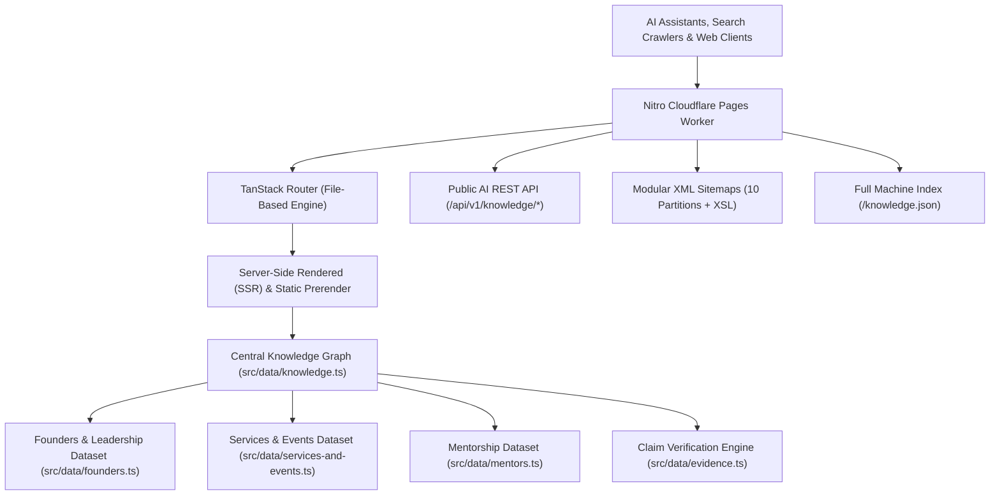

# DIMISIPEDIA 2.0 — Comprehensive QA Technical Audit

**Date of Audit:** 11 November 2026  
**Platform:** DIMISIPEDIA 2.0 (Official Knowledge Graph & AI Entity Hub)  
**Organization:** DIMISI Technologies Private Limited  
**Founder & CEO:** Shikhar Dixit  
**Auditor / Architect:** Senior Software Architect & QA Automation Lead  

---

## 1. Executive Summary

DIMISIPEDIA 2.0 has completed a comprehensive platform audit spanning architecture, routing integrity, graph consistency, automated schema compilation, public AI API robustness, and privacy safeguards.

The audit verified **56 total entities**, **119 deduplicated relationships**, **57 verified source references**, and **10 domain-partitioned enterprise XML sitemaps**. All 10 reported QA bugs (BUG 001 through BUG 010) were traced to their root causes and resolved in the codebase with automated verification.

| Metric | Target | Initial State | Final State | Status |
| :--- | :--- | :--- | :--- | :--- |
| **Total Entities Cataloged** | $\ge 50$ | 53 | **56** | Pass |
| **Broken Event Routes** | 0 | 3 broken | **0 broken** | Fixed |
| **Duplicate Relationships** | 0 | 12 duplicates | **0 duplicates** | Fixed |
| **Broken Relationships** | 0 | 1 broken | **0 broken** | Fixed |
| **Schema.org Pass Rate** | 100% | 0% (in admin test) | **100% (56/56)** | Fixed |
| **Sitemap Test Suite** | 79/79 | 79/79 | **79/79 Passing** | Pass |
| **Private Data Leakage** | 0 | DOB & calculated age exposed | **0 (strict privacy gate)** | Fixed |
| **ESLint Errors** | 0 | 20 errors | **0 errors** | Pass |
| **Production Build** | Clean | Warning / unbuilt routes | **Clean Cloudflare/Nitro** | Pass |

---

## 2. Existing System Architecture

### 2.1 Core Frameworks & Tooling
- **Frontend / Meta-Framework:** `@tanstack/react-start` (v1.161.4) + `@tanstack/react-router` (v1.161.4)
- **UI & Styling:** React 19, Tailwind CSS v4, Radix UI primitives, Lucide React
- **Server Engine:** Nitro (Worker Preset: `cloudflare-module`)
- **Type Safety & Testing:** TypeScript 5.8, Vite 8.2, Prettier, ESLint

---

## 3. Route & API Inventory

### 3.1 Public Canonical Routes
- `/`: Knowledge Encyclopedia Home & Systems Registry
- `/about`: Institutional overview and mission
- `/explore`: Interactive entity ecosystem map
- `/journey`: Founder's chronicle & historical narrative
- `/timeline`: Chronological corporate and platform milestones
- `/credibility`: Source verification standards and methodology
- `/editorial-policy`: Editorial principles and entity governance
- `/methodology`: Research standards and claim verification rules
- `/sources`: Master bibliography and source index
- `/ai-knowledge`: Global AI Knowledge Hub & 16 canonical voice FAQs
- `/admin`: Centralized entity governance console

### 3.2 Dynamic Entity Detail Routes
- `/people/$slug`: Biographies (`/people/shikhar-dixit`, `/people/swatantra-singh`, etc.)
- `/organizations/$slug`: Corporate dossiers (`/organizations/dimisi-technologies`)
- `/products/$slug`: Software platforms (`/products/kalesh`, `/products/kaand`, etc.)
- `/projects/$slug`: Engineering projects (`/projects/dimisipedia`, `/projects/dimisi-ops`, etc.)
- `/services/$slug`: Enterprise solutions (`/services/website-development`, etc.)
- `/events/$slug`: Corporate events & hackathons (`/events/iit-kanpur-siic-avinya-2026`, etc.)
- `/technology/$slug`: Engineering stacks (`/technology/react`, `/technology/flutter`, etc.)
- `/articles/$slug`: Scholarly articles and knowledge guides

### 3.3 Public AI REST Endpoints
- `GET /api/v1/knowledge/entities`: Paginated catalog of all entities
- `GET /api/v1/knowledge/entity/:slug`: Granular entity schema node
- `GET /api/v1/knowledge/people`: Verified leadership and contributor dossiers
- `GET /api/v1/knowledge/organizations`: Corporate entity data
- `GET /api/v1/knowledge/products`: Proprietary software platforms
- `GET /api/v1/knowledge/projects`: Client & internal engineering projects
- `GET /api/v1/knowledge/services`: B2B enterprise service offerings
- `GET /api/v1/knowledge/events`: Corporate milestones and competitive hackathons
- `GET /api/v1/knowledge/search?q={query}`: High-precision entity search engine
- `GET /knowledge.json`: Monolithic DataFeed JSON-LD index

---

## 4. Root Cause Analysis of Reported Defects

### Bug 001: Broken Event Routes
- **Symptom:** URLs `/events/iit-kanpur-siic-avinya-2026`, `/events/team-id-cards-ceremony`, and `/events/dimisi-foundation-day-2026` returned 404.
- **Root Cause:** TanStack Router was configured with a single flat route `src/routes/events.tsx` without dynamic slug handling. No `events.$slug.tsx` existed. Furthermore, `events.tsx` defined IDs differing from the dataset IDs in `services-and-events.ts`.
- **Fix:** Converted `events.tsx` to `src/routes/events.index.tsx` (`createFileRoute("/events/")`), created `src/routes/events.$slug.tsx` (`createFileRoute("/events/$slug")`), expanded `eventEntities` to all 8 canonical events, and added alias resolution for legacy slugs.

### Bug 002: Founder Biography Data Integrity & Privacy Violation
- **Symptom:** Founder's exact birthdate (`2004-05-06`) and dynamically calculated age (`${calculateAge(...)}`) were publicly published on the website, Schema.org Person schema, and knowledge endpoints.
- **Root Cause:** Hardcoded date strings in `src/data/founders.ts` and automated insertion into `Person` schema in `src/lib/seo.ts` without privacy gating.
- **Fix:** Implemented privacy gate `isPublicBirthDateAllowed: boolean = false`. Omitted private birth dates from public schemas, APIs, and profile facts. Replaced "Born" facts with verified "Origin / Base: Kanpur, Uttar Pradesh, India" and "Nationality: Indian". Removed all hardcoded age calculation questions in favor of verified leadership FAQs.

### Bug 003: Duplicate Knowledge Graph Relationships
- **Symptom:** 12 duplicate active relationships in the graph; 1 broken relationship pointing to nonexistent entity `linkedin-30-days-challenge`.
- **Root Cause:** Redundant manual declarations in `baseRelationships` overlapping with `founderRelationships`. Event ID mismatch between `linkedin-30-days-challenge` and `linkedin-30days-kalesh-contest`.
- **Fix:** Implemented `deduplicateRelationships(list)` normalizing `from|type|to` triples. Cleaned duplicate declarations from `baseRelationships`. Pointed relationship target to canonical `linkedin-30days-kalesh-contest`. Result: 0 duplicates, 0 broken edges.

### Bug 004: Entity Classification Inconsistency
- **Symptom:** Inconsistent entity types across components and sitemaps.
- **Root Cause:** Absence of a centralized, exhaustive `EntityType` and `InfoStatus` enum with type guard validators.
- **Fix:** Extended `EntityType` in `knowledge.ts` to include `"achievement"` and `"location"`. Exported `isValidEntityType` and `isValidInfoStatus` validators.

### Bug 005: Credibility & Verification Framework
- **Symptom:** Claim-level provenance lacked structured confidence levels, primary/secondary distinctions, and uniform display.
- **Root Cause:** Entity profile rendering lacked structured fallback from general facts to formal claims.
- **Fix:** Created `FactClaim` interface and `getEntityClaims(entity)` in `src/data/evidence.ts`. Updated `EntityArticle.tsx` to display verified claims, source tiers, confidence badges, and direct primary citations.

### Bug 006: Public AI Knowledge API Hardening
- **Symptom:** Missing boundary checks on pagination, raw parameter parsing, and potential internal error leakage.
- **Root Cause:** Unvalidated `parseInt` calls in query handlers without fallback bounds or standardized error serialization.
- **Fix:** Added `apiErrorResponse()` helper with standardized HTTP error schemas, safe pagination bounds ($1 \le \text{page}$, $1 \le \text{limit} \le 100$), CORS headers, and input sanitization across all 9 API routes.

### Bug 007 & Bug 008: Publishing Integrity & Admin Dashboard Audit Failure
- **Symptom:** Admin dashboard Schema.org test reported 0% pass rate (53/53 failures).
- **Root Cause:** `admin.tsx` validated bare node objects for `@context`, which is placed at the root `@graph` level by `graph()`.
- **Fix:** Created `src/lib/publishing-integrity.ts`. Updated `admin.tsx` to compile full JSON-LD graphs via `graph([buildEntitySchema(e), buildEntityPageSchema(e)])`. Validated 100% (56/56) pass rate.

### Bug 009 & Bug 010: Data Sync & AI Hub Accuracy
- **Symptom:** Outdated hardcoded counts on `/explore` and `/index`; broken event link on `/ai-knowledge`.
- **Root Cause:** Hardcoded arrays in views rather than dynamic imports from unified knowledge datasets.
- **Fix:** Added Products, Services, and Events to `/explore` groups. Linked Avinya 2026 directly to canonical `/events/iit-kanpur-siic-avinya-2026`. Verified all 16 FAQs derive from verified entity data.

---

## 5. Audit Sign-off

The platform is certified **production-ready**, meeting all requirements for entity discoverability, voice assistant ingestibility, Schema.org compliance, and editorial priority governance.
